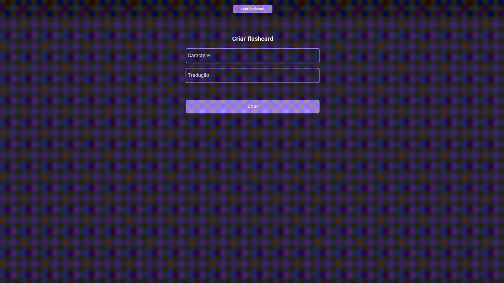

# MANDARIN STUDIO - Analisador de Tons em Mandarim

Ferramenta de análise de pronúncia em mandarim: grava a fala do usuário, extrai a curva de frequência (pitch), compara com um áudio de referência via Dynamic Time Warping e retorna uma avaliação de similaridade tonal.



> Projeto de estudo em Python, com foco em processamento de áudio e boas práticas de programação.

> **Status:** MVP funcional com interface gráfica implementada.

## Funcionalidades

- Criação de flashcards com geração automática de pinyin e áudio de referência
- Gravação da pronúncia pelo microfone
- Verificação da sílaba falada (reconhecimento de fala)
- Comparação do tom com a referência usando Dynamic Time Warping (DTW)
- Gráfico da curva de tom: sua pronúncia × referência
- Avaliação com percentual de similaridade
- Edição e exclusão de flashcards

## Como funciona

1. O usuário cria um flashcard com o hanzi e o significado. O sistema gera o pinyin e o áudio de referência (gTTS).
2. Na tela de prática, o usuário grava a própria fala.
3. O reconhecimento de fala (Vosk) verifica se a sílaba falada corresponde à esperada.
4. Se corresponder, a curva de pitch de ambos os áudios é extraída (`parselmouth`) e alinhada com `fastdtw`.
5. O sistema retorna uma categoria de resultado, o percentual de similaridade e o gráfico comparativo.

### Avaliação

| Similaridade | Resultado |
| ------------ | --------- |
| ≥ 90%        | Perfeito  |
| 70–89%       | Excelente |
| 50–69%       | Razoável  |
| < 50%        | Incorreto |

Se a sílaba falada não corresponder à esperada, o resultado é automaticamente **Incorreto**, e a comparação de tom não é executada.

## Tecnologias

- **Linguagem:** Python 3.10+
- **Interface:** customtkinter
- **Captura de microfone:** sounddevice + scipy
- **Análise de áudio:** parselmouth
- **Comparação de curvas:** fastdtw
- **Reconhecimento de fala:** Vosk
- **Áudio de referência:** gTTS
- **Gráficos:** matplotlib
- **Testes:** pytest

## Instalação

```bash
git clone https://github.com/akdellt/mandarin-studio.git
cd mandarin-studio
python -m venv .venv
.venv\Scripts\activate
pip install -e .
```

1. Baixe o modelo `vosk-model-cn-0.22` em [alphacephei.com/vosk/models](https://alphacephei.com/vosk/models)
2. Extraia em `data/model/`
3. Rode a aplicação: `python main.py`
4. Para rodar os testes: `pytest`

> A criação de flashcards requer conexão com a internet (geração do áudio de referência via gTTS).

## Estrutura do projeto

```
mandarinstudio/
├── analysis/       # extração de pitch e reconhecimento de fala
├── audio/          # captura de microfone e geração de áudio de referência
├── comparison/     # cálculo de DTW e avaliação do resultado
├── flashcards/     # manipulação de flashcards
├── ui/             # interface gráfica (customtkinter)
├── visualization/  # geração de gráficos
└── config.py
notebooks/          # testes e exploração no Jupyter
tests/              # testes unitários
data/               # áudios, flashcards e modelo Vosk (não versionado)
main.py             # ponto de entrada da aplicação
pyproject.toml
```

## Decisões técnicas

- **DTW em vez de comparação ponto a ponto:** falas têm durações diferentes, e o DTW alinha as curvas antes de medir a distância.
- **Normalização Z-score do pitch:** permite comparar vozes de registros diferentes (graves e agudas), já que o que importa é o formato da curva, não a frequência absoluta.
- **Validação do fonema antes do tom:** comparar o tom de sílabas diferentes não faz sentido, então o DTW só roda quando a sílaba está correta.
- **Flashcards sem restrição de hanzi único:** um mesmo caractere pode ter leituras e significados diferentes (ex: 还, "hái" ou "huán"), então cada flashcard tem um identificador próprio.
- **Testes automatizados** nas funções de análise, comparação e flashcards, incluindo casos de borda documentados.

## Limitações conhecidas

- Sílabas muito curtas ou faladas baixo podem ser cortadas pelo filtro de silêncio, e o reconhecimento de fala falha nesses casos.
- O reconhecimento de monossílabos isolados é menos preciso que o de palavras com mais de uma sílaba, pois o modelo tem menos contexto para decidir.

## Diário de bordo

O histórico de desenvolvimento está em [DEVLOG.md](DEVLOG.md).
